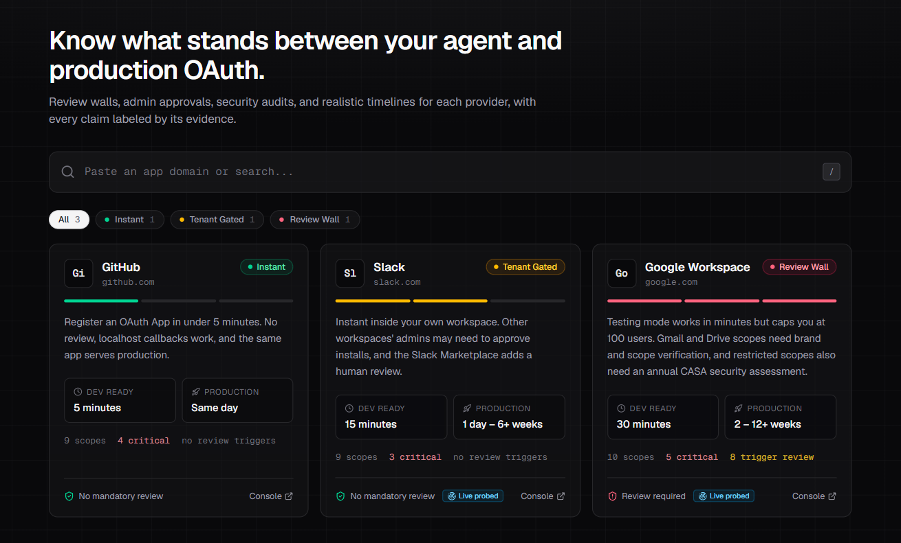
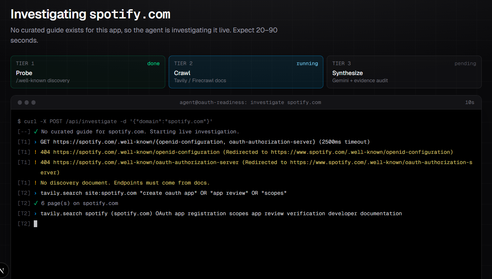
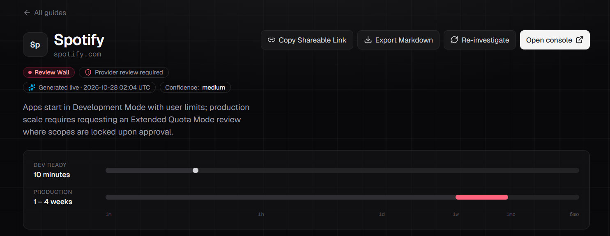
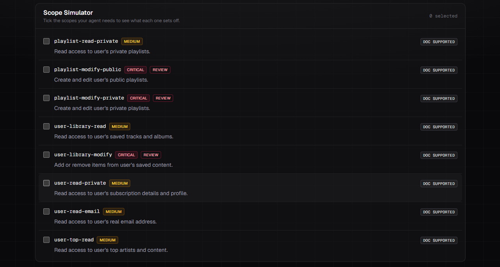
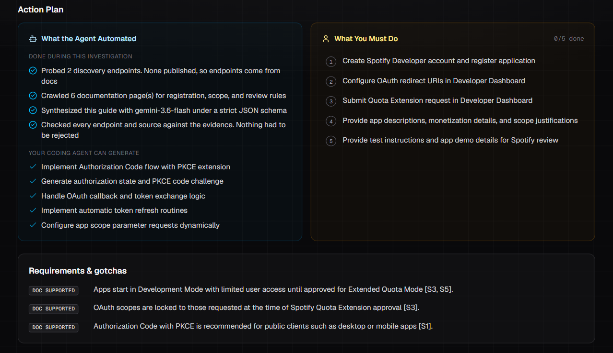
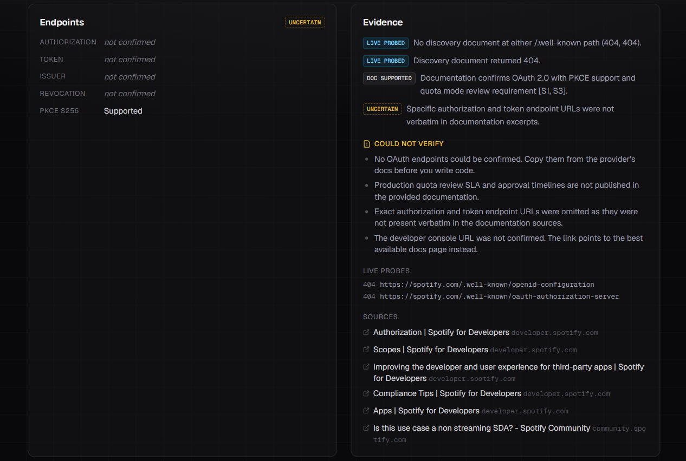

# Composio Take-Home Submission: OAuth Readiness Engine

**Candidate:** Sarath Peddireddy | **Email:** sarathpeddireddy93477@gmail.com

🔗 **Live Working Experience:** https://composio-integrations.vercel.app

💻 **Source Repository:** https://github.com/Sarath-peddireddy/composio-integrations

*Note: Please find the live links above. The remainder of this document serves as the project README, detailing the architecture, product decisions, and what was learned during the live investigations.*

---

# OAuth Readiness

**Know what stands between your AI agent and production OAuth before you write any code.**


An agent builder who wants users to "Connect Gmail" or "Connect Spotify" has to register an OAuth app with that provider first. Some providers let you do that in five minutes. Others put you behind a **Review Wall**: user caps, demo videos, domain verification, paid security audits, and weeks of waiting on a reviewer. Providers rarely say which one you'll face, so developers learn it the hard way, often after the integration is built.

OAuth Readiness closes that gap. Look up a provider and get a guide you can share. It tells you:

- **How hard it is:** one of three friction tiers, *Instant*, *Tenant Gated* or *Review Wall*.
- **How long it takes:** time to a working dev flow vs. time to production.
- **Which scopes cause trouble:** the ones that trigger review, audits or admin consent.
- **Who does what:** exactly what an agent can automate and what a human must do.
- **How sure we are:** every claim is labeled by its evidence: **Live Verified**, **Doc Supported** or **Uncertain**.

For apps outside the curated library, an agent investigates the provider live and generates the guide in about a minute.

---

## Contents

1. [The product experience](#1-the-product-experience)
2. [Core architecture: the 3-tier pipeline](#2-core-architecture-the-3-tier-pipeline)
3. [Engineering highlights](#3-engineering-highlights)
4. [Local setup & deployment](#4-local-setup--deployment)
5. [What I Learned & Corrected (Addressing Guideline #2)](#5-what-i-learned--corrected-addressing-guideline-2)
6. [Key product decisions](#6-key-product-decisions)
7. [Limitations & next steps](#7-limitations--next-steps)

---

## 1. The product experience

### The dashboard



The home page opens with a search bar (press `/` to focus it) over a library of curated guides. Each card shows three things a developer needs to triage a provider at a glance:

- **Friction tier:** a color-coded badge and a three-segment meter.
- **Timelines:** *Dev ready* vs. *Production*. The gap between them is the review wall.
- **Scope risk:** how many scopes are critical and how many trigger a provider review.

The search bar does double duty. Type `slack` to filter the library. Paste any domain or URL, such as `https://www.spotify.com/us/`, and it is cleaned up to `spotify.com`. If no curated guide matches, press Enter to send the agent.

The seed library covers one provider per tier:

| Provider | Tier | Dev ready | Production | Why it's in the library |
|---|---|---|---|---|
| GitHub | Instant | 5 minutes | Same day | The baseline: no review, and the same app serves production. |
| Slack | Tenant Gated | 15 minutes | 1 day – 6+ weeks | No provider review, but each customer workspace's admin can gate installs, and since 2025 non-Marketplace apps get much lower history rate limits. |
| Google Workspace | Review Wall | 30 minutes | 2 – 12+ weeks | 100-user cap, demo videos, domain verification, and an annual CASA audit for restricted Gmail/Drive scopes. |

### Live investigation: Spotify

Spotify isn't in the curated library. Typing `spotify.com` and pressing Enter opens `/guides/spotify.com` and starts the pipeline. The page streams each tier's progress into a terminal view as it happens; it is not a canned animation.



The run above shows the system working as designed:

- **Tier 1:** both `/.well-known` discovery paths redirect to `www.spotify.com` and return `404`. The pipeline logs that and moves on.
- **Tier 2:** Tavily finds 6 pages on `spotify.com`. The pages it keeps are mostly on `developer.spotify.com`, plus one community thread.
- **Tier 3:** Gemini turns them into a structured guide in about a minute.



**What the generated guide got right:**

- **Tier and review gate:** classified as **Review Wall** with *Provider review required*. Apps start in **Development Mode** with a user limit, and serving the public requires an **Extended Quota Mode** review.
- **Scope lock:** it found that scopes are locked to whatever you request at approval time. That gotcha is easy to miss and expensive to discover late, because adding a scope later means another review.
- **Scope risk:** the Scope Simulator marks `playlist-modify-public`, `playlist-modify-private` and `user-library-modify` as **critical + review**. Read scopes such as `user-read-email` and `user-top-read` are marked medium.

  

- **Action plan:** it splits the work into what an agent can generate (PKCE authorization-code flow, callback handling, token refresh) and what you must do yourself (register the app, submit the quota extension, provide scope justifications and demo details).

  

**What it refused to guess:** Spotify's endpoints (`accounts.spotify.com/...`) are well known, and the model very likely "knows" them. But they did not appear verbatim in any crawled excerpt, so the server-side audit left them as **not confirmed** and tagged the endpoint block **Uncertain** rather than ship an unverified URL. The 1–4 week timeline is likewise listed under *Could not verify*, because Spotify publishes no review SLA.



**What it missed:** see [What I Learned & Corrected](#5-what-i-learned--corrected-addressing-guideline-2). Spotify's current criteria are stricter than this guide says, and finding that out is exactly why every claim carries an evidence label.

---

## 2. Core architecture: the 3-tier pipeline

```
 Browser                          POST /api/investigate  { "domain": "spotify.com" }
   │                                       │   (streams NDJSON progress events)
   │                    ┌──────────────────┴───────────────────┐
   │                    ▼                                      ▼
   │          Fast path (no external calls)          Live investigation
   │          • curated guide (data/curated.ts)        │
   │          • server cache (6h TTL)                  ├─ Tier 1 · Probe       deterministic, no LLM
   │                                                   ├─ Tier 2 · Crawl       Tavily → Firecrawl fallback
   │                                                   ├─ Tier 3 · Synthesize  Gemini + strict responseSchema
   │                                                   └─ Audit  · Finalize    server re-checks every claim
   ▼                                                                │
 /guides/[slug]  ◄──────────────────── OAuthGuideSpec ◄─────────────┘
```

Every guide, curated or generated, conforms to one contract, [`OAuthGuideSpec`](./types/oauth.ts), so the UI renders both identically.

### Tier 1: deterministic network probe ([`lib/investigate/probe.ts`](./lib/investigate/probe.ts))

- Fetches `https://{domain}/.well-known/openid-configuration` (OIDC Discovery) and `/.well-known/oauth-authorization-server` (RFC 8414) **in parallel**, each with a **2,500 ms** timeout.
- Keeps only a whitelist of fields: `issuer`, the `authorization`, `token`, `revocation` and `userinfo` endpoints, `scopes_supported` and `code_challenge_methods_supported`. A JSON body without an authorization or token endpoint is rejected as "not a discovery doc".
- Never throws. Timeouts, DNS failures, non-JSON pages and 404s are recorded as `ProbeAttempt`s and shown in the guide's *Live probes* audit trail.
- When it succeeds, these endpoints override anything the LLM says and are labeled **Live Verified**. PKCE support is read straight from `code_challenge_methods_supported`.

### Tier 2: policy & doc crawler ([`lib/investigate/crawl.ts`](./lib/investigate/crawl.ts))

- **Primary search:** a Tavily query restricted to the provider's own domain: `site:{domain} "create oauth app" OR "app review" OR "scopes"`.
- **Broad search fallback:** runs when fewer than 2 pages come back, or when the probe found no endpoints and the docs don't show any. Many providers keep docs on another domain (`slack.com` → `docs.slack.dev`, `notion.so` → `developers.notion.com`). Off-domain results are kept only if they name the provider, so generic OAuth pages from other companies can't leak in.
- **Firecrawl deep scrape:** if the combined text is under 3,000 characters, the top page is scraped for full markdown.
- **12,000-character budget:** each page is split into paragraphs, the paragraphs are scored on OAuth terms (`client_id`, `redirect`, `scope`, `verification`, `audit`, `admin`...), and the most relevant ones are kept in their original order. The model sees the policy text, not navigation menus.

### Tier 3: Gemini synthesis engine ([`lib/investigate/synthesize.ts`](./lib/investigate/synthesize.ts))

- Uses `@google/genai` with `responseMimeType: "application/json"` and a **`responseSchema` that mirrors `OAuthGuideSpec`**: enums for tier, risk level and evidence labels, required fields, and property ordering. The output is schema-valid JSON, not "JSON-ish text we hope parses".
- The system prompt enforces the evidence rules:
  - **Endpoints:** copied exactly from Tier 1, or taken verbatim from Tier 2, or left as `""`.
  - **Evidence labels:** `Live Verified` only for facts in the probe JSON, `Doc Supported` only for facts stated in a cited source, `Uncertain` for everything else, including the model's own background knowledge.
  - **Confidence notes:** every sentence starts with `[LIVE PROBED]`, `[DOC SUPPORTED]` or `[UNCERTAIN]`.
  - **Unknowns:** no undocumented review SLAs or audit prices stated as fact. They go in `uncertainties`.
- Temperature 0.2 with a low thinking level, since this is extraction, not creative writing.

### Streaming API

`POST /api/investigate` returns `application/x-ndjson`, one event per line, so the UI can show each tier as it runs:

```jsonc
{"type":"step","tier":1,"status":"warn","message":"404 https://spotify.com/.well-known/openid-configuration"}
{"type":"step","tier":2,"status":"ok","message":"6 page(s) on spotify.com"}
{"type":"step","tier":3,"status":"ok","message":"Audit: every endpoint and source traced to evidence"}
{"type":"result","guide":{ /* OAuthGuideSpec */ }}
```

Try it from the terminal:

```bash
curl -N -X POST http://localhost:3000/api/investigate \
  -H "Content-Type: application/json" \
  -d '{"domain":"gitlab.com"}'
```

Pass `"refresh": true` to bypass the cache.

---

## 3. Engineering highlights

### SSRF protection

`/api/investigate` makes the server fetch URLs built from user input. That is a textbook **server-side request forgery (SSRF)** risk: the classic attack targets the cloud metadata service (`169.254.169.254`, `metadata.google.internal`) to steal instance credentials, or reaches internal services such as `10.0.0.5:8080`.

[`lib/domain.ts`](./lib/domain.ts) and the probe defend in layers:

| Layer | What it blocks |
|---|---|
| **Input normalization** (`toDomain`) | Strips scheme, `www.`, path and port, then accepts only a strict hostname pattern. Anything else, such as `http://evil@10.0.0.1:8080/x`, is rejected outright and never becomes a fetchable URL. |
| **Host allow-check** (`isSafePublicHost`) | `localhost` and `*.localhost`; **every IPv4 literal**, which covers `10.x.x.x`, `127.x`, `192.168.x`, `172.16/12` and `169.254.169.254`; IPv6 literals; private suffixes `.internal` (covers `metadata.google.internal`), `.local`, `.lan`, `.corp`, `.home`, `.test`. The hostname must end in a real alphabetic TLD. |
| **Redirect hygiene** | Redirects are followed **manually** (`redirect: "manual"`), at most 2 hops, HTTPS only, and **every hop is re-checked**. A public host can't bounce the probe to an internal one. |
| **Resource limits** | 2.5 s timeout per request and a 256 KB response cap. Only whitelisted discovery fields are parsed. |

The page route uses the same check: `/guides/localhost` and `/guides/10.0.0.1` return 404 before any fetch happens.

> **Known gap:** the check validates hostnames, not resolved IPs. A public domain whose DNS points at a private address (DNS rebinding) would pass. The production fix is to resolve first and pin the connection to a vetted IP, or to send probes through an egress proxy with private ranges denied.

### Anti-hallucination engine

The model's JSON is treated as a **draft**. [`lib/investigate/finalize.ts`](./lib/investigate/finalize.ts) re-checks it against what the agent actually saw before anything reaches the UI:

- **Endpoints:**
  - If the probe succeeded, its values replace the model's entirely.
  - Otherwise each URL is kept only if it is HTTPS and appears **verbatim** in the crawled text. Everything else is dropped and logged.
  - This is why Spotify's endpoints show *not confirmed*.
- **Evidence labels are capped at what we can prove:**
  - `Live Verified` drops to `Doc Supported` when no probe succeeded.
  - `Doc Supported` drops to `Uncertain` when no docs were crawled, or when the claimed scope string doesn't appear in them.
  - A scope listed in the live `scopes_supported` is upgraded to `Live Verified`.
- **Sources:** replaced with the pages the crawler actually fetched. Any URL the model "cited" but the agent never visited is rejected.
- **Console link:** kept only if it appears in the sources. Otherwise it falls back to the best docs page, with an uncertainty note.
- **Confidence:**
  - A server-written `[LIVE PROBED]` sentence with the real HTTP statuses is put first.
  - Notes the model left untagged get `[UNCERTAIN]`.
  - The status is capped: `low` with zero docs, at most `medium` with thin evidence or 3+ rejected claims.
- **Visible audit:** every rejected claim is listed on the guide page under *Rejected model claims*, next to the live-probe log and the source list.

### Graceful LLM degradation

Gemini Flash regularly returns `503 high demand` at peak times; during development most first attempts did. The synthesis step treats that as normal:

- **Model chain:** `gemini-3.8-flash → 3.7 → 3.6 → 3.5 → flash-latest → 3.5-flash-lite`. Pin a model with `GEMINI_MODEL`.
- **Key rotation:** `GEMINI_API_KEY`, then `GEMINI_FB1_API_KEY`, then `GEMINI_FB2_API_KEY`.
- **Errors are handled by type:**

  | Error | Response |
  |---|---|
  | `503` (model overloaded) or a 40 s timeout | Skip to the next model. |
  | `429` (quota), `401` / `403` (bad key) | Try the next key on the same model. |
  | `400` / `404` (retired model, e.g. `gemini-2.5-flash` for new users) | Mark the model dead for this run. |
  | Malformed JSON | Retry. |

- **Retry passes:** if every model is busy, up to 3 passes with 2.5 s → 5 s backoff, inside a 95 s total budget, under the route's `maxDuration` of 120 s.
- **Visibility:** each fallback shows up in the terminal log (`gemini-3.8-flash → 503 … trying next model`), so a slow run explains itself.

### Fast-fail on zero evidence

The most dangerous output is a confident guide about nothing. When Tier 1 finds no discovery document **and** Tier 2 finds no relevant documentation, the pipeline **stops before calling the LLM** and tells the user:

```
[T3] ✗ No discovery document and no OAuth documentation found. Skipping synthesis.
Found no OAuth evidence for zzq-nonexistent-oauth-app.io. Check the spelling, or try the provider's main or developer domain.
```

This came from a bug found in testing. Before the provider-relevance filter existed, a made-up domain pulled in generic OAuth pages from Google and Figma, and the model wrote a "Review Wall" guide for an app that doesn't exist. Two more cost guards sit alongside it:

- **Client disconnects:** if the viewer closes the tab before Tier 3, the Gemini call is skipped.
- **Curated fast path:** curated domains, including subdomains such as `api.github.com`, never touch Tavily or Gemini.

---

## 4. Local setup & deployment

### Prerequisites

- Node.js **20.9+** (developed on Node 24)
- API keys:

| Variable | Required | Used by | Get one |
|---|---|---|---|
| `GEMINI_API_KEY` | **Yes** (live investigations) | Tier 3 | [Google AI Studio](https://aistudio.google.com/apikey) |
| `TAVILY_API_KEY` | Strongly recommended | Tier 2 search | [tavily.com](https://tavily.com) |
| `FIRECRAWL_API_KEY` | Optional | Tier 2 deep-scrape fallback | [firecrawl.dev](https://firecrawl.dev) |
| `GEMINI_FB1_API_KEY`, `GEMINI_FB2_API_KEY` | Optional | Fallback keys on quota errors | Google AI Studio |
| `GEMINI_MODEL` | Optional | Pin a specific model | n/a |

The curated guides work with **no keys at all**. Without Tavily, live runs rely on the probe alone and usually stop at the zero-evidence fast-fail.

### Run locally

```bash
git clone <your-fork-url> oauth-readiness
cd oauth-readiness
npm install

cp .env.example .env        # then fill in GEMINI_API_KEY, TAVILY_API_KEY, FIRECRAWL_API_KEY
npm run dev                 # http://localhost:3000
```

Then:

1. Open `http://localhost:3000` and click **Google Workspace**. Tick `gmail.readonly` in the Scope Simulator to see the CASA audit warning.
2. Paste `gitlab.com` into the search bar and press Enter to watch a live investigation. GitLab publishes a discovery document, so its endpoints come back **Live Verified**.
3. Use **Export Markdown** to drop the guide into a README, ticket or Slack thread.

| Command | Purpose |
|---|---|
| `npm run dev` | Dev server with hot reload |
| `npm run build` | Production build (includes type checking) |
| `npm start` | Serve the production build |
| `npm run typecheck` | `tsc --noEmit` |

### Deploy to Vercel

**Option A: dashboard**

1. Push the repo to GitHub. `.env` is git-ignored; only `.env.example` is committed.
2. In Vercel, choose **Add New → Project**, import the repo, and keep the Next.js preset defaults.
3. Under **Settings → Environment Variables**, add `GEMINI_API_KEY`, `TAVILY_API_KEY` and `FIRECRAWL_API_KEY`, plus the optional fallbacks.
4. Deploy.

**Option B: CLI**

```bash
npm i -g vercel
vercel link
vercel env add GEMINI_API_KEY
vercel env add TAVILY_API_KEY
vercel env add FIRECRAWL_API_KEY
vercel --prod
```

**Deployment notes:**

- `/api/investigate` sets `maxDuration = 120` and runs on the Node.js runtime. Confirm your Vercel plan allows a 120 s function duration, or lower `maxDuration` together with `TOTAL_BUDGET_MS` in `synthesize.ts`.
- The response streams as NDJSON, which works on Vercel's Node runtime without extra configuration.
- The guide cache lives in memory per function instance. On serverless, a shared link to a live guide may trigger a fresh investigation. See [Limitations](#7-limitations--next-steps).

### Project layout

```
app/
  page.tsx                    Dashboard (search bar, tier filters, guide cards)
  guides/[slug]/page.tsx      Curated slug, curated domain, or live investigation
  api/investigate/route.ts    Streaming 3-tier pipeline
components/
  Dashboard.tsx, GuideCard.tsx, FrictionBadge.tsx
  guide/                      GuideView, ScopeSimulator, ActionPlan, TimeGauge,
                              LiveInvestigation (terminal), Evidence badges
lib/
  domain.ts                   Input normalization + SSRF host guard
  investigate/                probe · crawl · synthesize · finalize · cache
  markdown.ts                 Export Markdown
  duration.ts                 "2 – 12+ weeks" → log-scale gauge
data/curated.ts               Seed guides (GitHub, Slack, Google Workspace)
types/oauth.ts                OAuthGuideSpec contract + stream event types
```

---

## 5. What I Learned & Corrected (Addressing Guideline #2)

> *Guideline #2: "Check a sample of the guidance against real sources or setup attempts. Show what you learned, corrected, or could not verify."*

I tested the guidance against real provider docs, live HTTP probes, and live agent runs. A few findings changed the product and the architecture:

**1. Correcting Slack's PKCE support, and the bot-token trap it hides.**
My first draft of the Slack guide marked PKCE as *unknown*. Slack's [Using PKCE](https://docs.slack.dev/authentication/using-pkce/) page showed that it is supported (S256 only), with a catch that matters to agent builders:

- Enabling PKCE is a **one-way** switch that permanently marks the app as a public client.
- After that, `localhost` and custom-scheme redirects count as **desktop redirects**.
- Desktop redirects **cannot request bot scopes**.

So a developer who turns on PKCE for local testing can lock themselves out of bot tokens, which is the token type most Slack agents need. The Slack guide now marks PKCE as supported and states this trap directly in its *Requirements & gotchas*.

**2. Handling GitHub's discovery failure: the pipeline must fail open.**
Probing GitHub while building the seed library, both `/.well-known/openid-configuration` and `/.well-known/oauth-authorization-server` returned **404**. GitHub, one of the most popular OAuth providers, publishes no RFC 8414 / OIDC discovery document for user OAuth. I learned that standards-based discovery is a bonus, not a foundation. The pipeline therefore **fails open**: a failed Tier 1 probe is logged as evidence, never as an error, and Tier 2 takes over and extracts endpoints from documentation text.

GitHub itself is served from its curated guide, where the endpoints are labeled *Doc Supported* rather than *Live Verified*. The fail-open path is proven on live runs:

- **HubSpot:** the probe returned `406`. The endpoints were recovered verbatim from the docs.
- **Spotify:** the probe returned `404`. The endpoints weren't in the crawled text, so they were left as *not confirmed* instead of guessed.

**3. What could not be verified: Google's CASA audit cost.**
Google requires restricted scopes (`gmail.readonly`, `drive`, ...) to pass an annual **CASA** security assessment. The fee is set by third-party labs and is **not published in Google's documentation**. The Google Workspace guide labels the cost **Uncertain** and lists it under *Could not verify*, instead of quoting a number. The live agent follows the same rule: the Tier 3 prompt forbids stating undocumented review timelines or audit pricing as fact and routes them to `uncertainties`.

**4. Live generation can miss policy: the Spotify case.** Details below. The agent caught Spotify's review gate but not its 250k monthly-active-user threshold, which is why evidence labels and curated promotion both matter.

**5. A bug found by testing a made-up domain.** Before the provider-relevance filter existed, a nonexistent domain pulled in generic OAuth pages from Google and Figma, and the model wrote a confident guide for an app that doesn't exist. That led to two fixes: the off-domain relevance filter in Tier 2 and the zero-evidence fast-fail before Tier 3.

### Evidence log

**Curated guides (checked 2026-10-28):**

- **Discovery probes:**
  - Google: `200`. Endpoints and `code_challenge_methods_supported: [plain, S256]` confirmed.
  - Slack: `200`, but the doc covers *Sign in with Slack* (OIDC) only. The bot-install `oauth.v2` endpoints come from the docs, and the guide says so.
  - GitHub: `404` on both paths. Its endpoints are labeled Doc Supported.
- **Links:** all 18 cited source URLs were fetched and returned `200`.
- **Claims checked against live doc text:**
  - GitHub's 10-tokens-per-user/app/scope cap and loopback-port flexibility.
  - Google's 7-day refresh-token expiry in Testing mode and its 100-refresh-token limit.
  - That Slack token rotation can't be turned off once enabled.
- **Corrections made:**
  - Slack PKCE: changed from *unknown* to supported, and the one-way public-client / no-bot-scopes trap was added (see finding 1).
  - Slack's docs moved to `docs.slack.dev`, so the citations were updated.
  - "Slack requires HTTPS redirect URLs" could not be confirmed and was moved to *uncertainties*.
- **Labeled Uncertain on purpose:** review turnaround times (no provider publishes an SLA) and CASA assessment pricing (it varies by lab).

**Live investigations tested:**


| Domain | Result | Notes |
|---|---|---|
| `gitlab.com` | Instant, confidence high | Discovery doc found. Endpoints, PKCE and all 6 scopes **Live Verified**. |
| `hubspot.com` | Tenant Gated | No discovery doc (`406`). Endpoints recovered verbatim from docs. Flags the Super Admin install requirement. |
| `notion.so` | Instant, confidence medium | The broad search found `developers.notion.com`. The token URL is confirmed; the authorize URL was **not**, and is shown as such. |
| `spotify.com` | Review Wall, confidence medium | See below. |
| Made-up domain | Stopped | Zero-evidence fast-fail. No LLM call. |

**What the Spotify guide missed.** I checked the generated guide against [Spotify's quota-modes documentation](https://developer.spotify.com/documentation/web-api/concepts/quota-modes):

- **Development Mode:** limited to **5 users**, and requires the owner to have Spotify Premium.
- **Extended Quota Mode:** **since May 15, 2025, only organizations can apply, not individuals.** They need a launched service with **at least 250k monthly active users**, and must apply from a company email.

The generated guide caught the review gate but not these thresholds. Its "1–4 weeks" estimate is therefore misleading for most agent builders: realistically, Spotify is **closed to new indie and early-stage apps**. The crawler's 12k-character budget favored the authorization and scopes pages over the quota-modes page. This is the strongest argument for promoting high-traffic providers to curated guides, and for adding a targeted "production access / quota / app review" query to Tier 2.

---

## 6. Key product decisions

- **Friction tier first, not a tutorial.** The first question a developer has is "hours or weeks?", not "what is the token URL?". The tier badge and the dev-vs-production gauge answer it in two seconds. Everything else is detail.
- **The Scope Simulator is the core interaction.** Within a provider, scope choice sets the timeline. Google with `drive.file` is a days-long verification; Google with `drive.readonly` adds an annual paid audit. Making that cause and effect clickable teaches developers to request less.
- **Agent vs. human, explicitly.** The assignment asks what an agent can do and where the developer must take over. The Action Plan splits those, and for live guides it separately lists what the agent *actually did* during the investigation. Human steps are a checklist with saved progress, because they happen over days.
- **Evidence labels everywhere, including curated content.** A guide that is right 90% of the time but doesn't say which 90% is dangerous when an approval timeline depends on it. Showing *Uncertain* builds more trust than hiding it.
- **Deterministic before generative.** RFC 8414 / OIDC discovery is a free, exact source of truth for endpoints, so it runs before the LLM and overrides it.
- **Curated guides for the long tail of pain, live generation for coverage.** Hand-checked guides are worth their cost for providers with complex review walls (Google, Meta, Spotify). Live generation covers the next thousand apps at "good starting point" quality.

---

## 7. Limitations & next steps

- **Live guides are drafts.** They can miss policy that sits on pages the crawler didn't prioritize, as the Spotify case shows. Next step: a second, targeted Tier 2 query for "production access / quota / app review / verification", plus per-provider doc-domain hints.
- **No persistence.** Live guides are cached in memory for 6 hours per server instance. Next step: store guides in a KV/Postgres store keyed by domain and version them, so shared links are stable and changes can be compared over time.
- **SSRF guard is hostname-based** (see the DNS-rebinding note above).
- **The agent doesn't attempt registration.** It probes and reads, but it doesn't create OAuth apps in provider consoles, because that needs authenticated browser sessions and accepting terms on the user's behalf. A natural next tier is a browser agent that pre-fills console forms and stops at human-only steps (ToS acceptance, DNS, video upload).
- **Time estimates are model-generated when undocumented.** They are always listed under *Could not verify*, but they are still estimates.
- **No rate limiting on `/api/investigate`.** Each live run spends Tavily and Gemini quota. Add per-IP limits before exposing it publicly.
- **Curated library is 3 providers.** The goal is 100. The schema and evidence model are designed so curated guides can be generated live, then reviewed and promoted.
